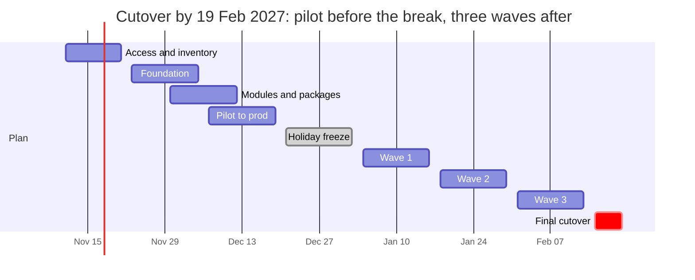

# 12-week plan

Copilot reads this table for `/plan-chart`, `/weekly-update` and `/migration-timeline`. Edit the dates here when the plan changes.

| Stage | Start | End | Gate |
|---|---|---|---|
| Access and inventory | 2026-11-11 | 2026-11-20 | Access granted, inventory and waves signed off |
| Foundation | 2026-11-23 | 2026-12-04 | Runners, OIDC, Library, permissions, scanning, logs ready |
| Modules and packages | 2026-11-30 | 2026-12-11 | Module repos tagged, packages in GitHub |
| Pilot to prod | 2026-12-07 | 2026-12-18 | Pilot deployed to prod with one rollback |
| Holiday freeze | 2026-12-21 | 2027-01-01 | No changes |
| Wave 1 | 2027-01-04 | 2027-01-15 | Wave repos cut over |
| Wave 2 | 2027-01-18 | 2027-01-29 | Wave repos cut over |
| Wave 3 | 2027-02-01 | 2027-02-12 | Wave repos cut over |
| Final cutover | 2027-02-15 | 2027-02-19 | ADO pipelines disabled, repos read-only |

Mermaid end dates are exclusive, so each bar's end is the day after the last working day.
